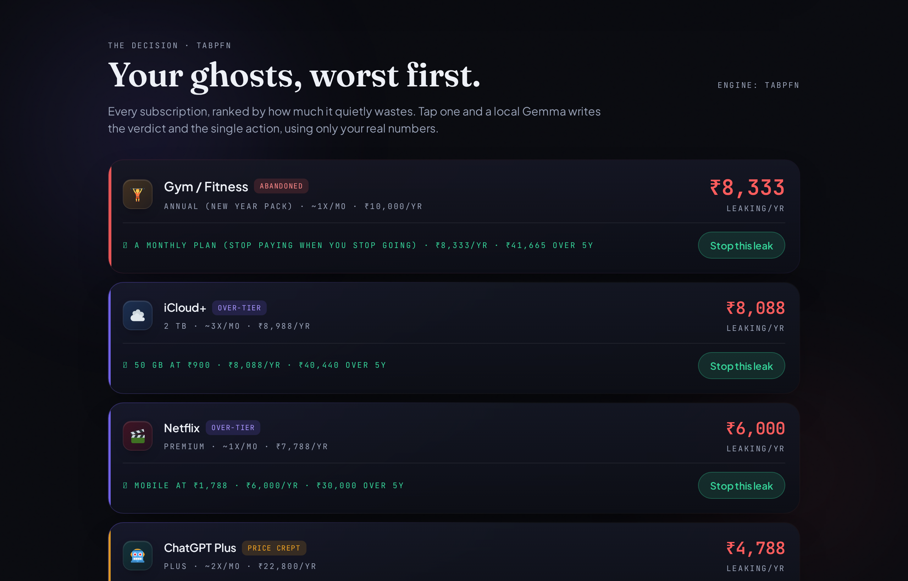
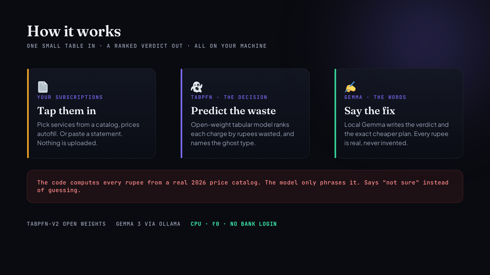

*This is a submission for the [Hacktoberfest Open-Source AI Challenge Week 4: Ghost in the Machine](https://dev.to/challenges/hacktoberfest-week4-2026-10-26)*

## What I Built

Back in college, I used to wonder how companies could afford to sell certain products at unbelievably low prices. Printers that practically cost nothing. Gaming consoles sold at a loss. Coffee machines priced far below what they seemed worth. It took me a while to understand what was actually happening: the company wasn't making its money from the product itself. It was making money from everything that came after. The ink cartridges, the games, the coffee pods, the memberships. The initial purchase was simply an entry point into a much longer revenue stream.

Once I understood that business model, I started noticing it everywhere. Today, subscriptions have become its most common form. An app costs nothing to download, the first month comes free, or a device is heavily discounted. But the real money comes from the recurring payment that follows, often long after the customer has stopped thinking about the original offer. The clever part is that the charge becomes so routine that you barely register it. The recurring payment isn't an accidental consequence of the business model. It is the entire point.

And I realised I had fallen for it myself.

When I upgraded to Airtel Black, I received an Amazon Prime membership free for one year as part of the package. Naturally, I thought it was a great deal. But when that complimentary period ended, my account was automatically charged Rs 1,499 for a full Prime membership.

There was just one problem: I had never watched anything on Prime Video. My only reason for keeping Prime was the shopping and delivery benefits. What I hadn't realised was that Amazon offers a separate Prime Shopping Edition for Rs 399 annually, which provides exactly the benefits I actually use, without including video streaming.

In other words, I was paying Rs 1,499 for a package when a Rs 399 plan was perfectly sufficient. That meant Rs 1,100 disappearing from my account every year for a service I never used. The complimentary membership had been the attractive introductory offer. The expensive renewal was where the real business began.

This wasn't a case of forgetting to cancel something. It was a different kind of waste: continuing to pay for a subscription that no longer matches your actual needs.

After that, I began recognising similar situations all around me. The annual gym membership paid for enthusiastically in January but abandoned by February, as happens with around 80% of people. The cloud storage plan with far more capacity than anyone needs. Multiple music services charging separately for essentially the same experience.

The underlying idea became the foundation for what I wanted to build.

The theme is Ghost in the Machine. I interpreted it as something quite literal: invisible financial drains hiding inside ordinary monthly expenses. Small recurring charges that escape your attention, quietly reducing your available money while you focus on everything else. These payments survive because people rarely stop to examine them. I wanted to create something that does exactly that examination.

Introducing Subscription Ghost.

Subscription Ghost is an open-weight model designed to analyse a person's subscription list, identify payments that may be unnecessary, and predict which subscriptions are effectively financial ghosts. Instead of simply pointing out the problem, it recommends one specific action for each subscription and calculates the exact amount of money that could be saved.

It operates entirely on the user's own machine, costs nothing to run, and never requires access to bank login credentials.

It identifies four distinct categories of subscription waste:

Over-tier: You're paying for a premium bundle but only using a small part of it, even though a cheaper plan would meet your needs. My Amazon Prime example falls into this category, with potential savings of Rs 1,100 annually.
Abandoned: You've paid for an extended period in advance but have effectively stopped using the service, like the gym membership that gets forgotten after New Year.
Dead: The subscription remains active and continues charging you, despite you barely opening or using it.
Price crept: The subscription cost has gradually increased, but you haven't noticed how much more you're now paying.

To test the idea, I ran it against a sample person's list of nine subscriptions. The model identified Rs 29,056 in potential annual savings. More importantly, it didn't just highlight suspicious expenses; it identified a specific, cheaper alternative for every one.

The most expensive problem turned out to be something quite unexpected.

It was iCloud+, costing Rs 8,988 annually for the 2 TB storage plan. The person using it had only around 40 GB of photos and other data. Moving to the 50 GB plan, which costs Rs 900 per year, would still leave plenty of room. That single downgrade would save Rs 8,088 every year on storage capacity that was never being used.

The gym membership came second, accounting for Rs 8,333 in annual waste. My original Amazon Prime example, which had inspired the project in the first place, appeared much further down the list at Rs 1,100.

That result highlighted something important: the biggest financial leaks aren't necessarily the subscriptions that attract the most attention. Sometimes, the most expensive waste is hiding in an ordinary-looking monthly or annual payment. Ranking subscriptions by their predicted savings makes these problems much easier to spot than manually reviewing a transaction statement.

But there is another category of waste that is even harder to identify: paying multiple times for the same capability.

Consider the same sample user. They were paying for Amazon Prime, YouTube Premium, and Spotify simultaneously. All three services offer music playback. Individually, each subscription might seem reasonable. Looking at them separately wouldn't necessarily reveal anything wrong.

However, when Subscription Ghost evaluates the entire collection together, it recognises that the user is paying for three services that overlap in one important area.

Its recommendation is to retain the music service already included in something the person pays for and discontinue the other two. The potential savings from this overlap alone amount to Rs 5,376 annually.

I deliberately made this feature conservative. It only identifies overlapping subscriptions when the underlying capability is genuinely duplicated. It shouldn't recommend cancelling a music service that someone actively values and regularly uses just because another subscription also happens to offer music.

That distinction is important to the entire philosophy behind the project.

A poorly designed subscription analyser would simply tell everyone to cancel as many services as possible. But that's not what I wanted to build. In fact, Subscription Ghost identifies three subscriptions in the sample list as worth it and explicitly recommends keeping them.

The objective isn't to eliminate subscriptions or make people feel guilty about spending money. It's to distinguish between services that genuinely add value and services that continue taking money without providing enough in return.

Because a financial tool that constantly tells you to cancel everything isn't particularly useful. Eventually, you'll stop listening to it.

The real goal is not to spend less on everything. It's to stop spending on things that no longer deserve your money.

---

## Demo

Try it now, no setup, nothing uploaded: **https://subscription-ghost-rmh5.onrender.com**

Open it on your phone too. It opens on a real sample person's subscriptions so you see the value with zero effort, then you can tap services from a catalog to add your own (the price fills in automatically). Tap any ghost to see the verdict and the fix, then hit "Stop this leak" and watch the total drop.

Try this in ten seconds: tap the gym row. It tells you that paying a year up front and stopping in February is Rs 8,333 gone, and that a monthly plan would have let you stop paying the month you stopped going. Then tap "Stop this leak" on it and watch Rs 8,333 jump out of the leaking total into the reclaimed counter. That is the whole loop: see the leak, understand it in one line, close it.



---

## Code



```bash
# runs on a plain CPU, no GPU, no key
python3 -m venv .venv && source .venv/bin/activate
pip install -r requirements.txt
ollama pull gemma3:1b          # optional; falls back cleanly without it
python scripts/build_dataset.py
python scripts/validate.py     # asserts the whole pipeline end to end
python run.py                  # http://127.0.0.1:8080
```

---

## How I Built It

Two open models, one job each, both on CPU.



**TabPFN-v2 decides.** Prior Labs' open-weight tabular foundation model reads a small table of subscriptions (what you pay, how often you use it, how long you have had it, whether the price crept, whether you prepaid a year) and predicts the rupees each one wastes per year, in a single forward pass, no training loop of my own. It then ranks them worst first. This is exactly what TabPFN is built for: small tables, instant predictions. I use the open v2 weights so the whole stack is genuinely open, and it runs on CPU in a couple of seconds.

I went with a ranked prediction on purpose, not a rulebook of "if you use it fewer than N times, cancel." Thresholds break the moment real life does not match them: someone who opens an app twice a month might be getting full value, and someone who opens it daily out of habit might be wasting money on a tier they outgrew. The model learns the shape of waste from the whole table instead of from one brittle cutoff, and the number that matters for a triage tool is the order, which is why I score the ranking, not just the raw rupees.

**Gemma 3 writes.** A local Gemma 3 model, served through Ollama, turns the decision into two plain lines: the verdict and the one action. It is handed the real numbers and is forbidden from inventing any price or figure that is not supplied. Every rupee it writes is checked against the numbers I gave it, and a line that smuggles in a figure I never provided is stripped.

**The catalog keeps it honest.** Prices and cheaper tiers come from a real 2026 price catalog (Amazon Prime, Netflix, JioHotstar, Spotify, gym memberships, and more), not from the model. That is how it can say "move to Prime Shopping Edition at Rs 399" and have that be a real plan, not a hallucination.

**A deterministic fallback** covers both halves, so if the model weights or Ollama are not available the app still works and the response says which path ran. It never hard-fails.

The front end is a single file, Tailwind and GSAP, with a premium dark finance look that works on phone, tablet, and desktop.

And because it is a prediction, I score it honestly. I fit TabPFN on 75% of the subscriptions and test it on the 25% it has never seen:

```
scorecard (held-out, synthetic subscriptions)
  engine:              tabpfn
  mae_rupees:          523     # waste prediction lands within ~500 rupees
  rank_correlation:    0.971   # the worst-first ORDER is strong
  precision_at_k:      0.85    # of the 20 it flags most wasteful, 17 are truly top tier
  rupees_captured_pct: 96      # its top flags capture 96% of the real rupee waste
  missed:              3       # and it still MISSES 3 real ghosts
```

That `missed: 3` is the number that matters. Subscription Ghost is a triage aid that gets the ordering mostly right and sometimes wrong, not an oracle. The training data is synthetic and labeled as such, because no public dataset of "which of your subscriptions you secretly do not use" exists. The prices it reasons over, though, are real.

---

## Why Does Open Innovation Matter?

**Because a tool that finds money leaks should not be one.** The popular subscription apps ask to link your bank account and then watch every transaction you make, forever, and many charge a monthly fee to do it. There is a real irony in paying a subscription to cancel your subscriptions, and in handing your entire financial history to a third party to find out which charges you forgot.

Subscription Ghost runs TabPFN and Gemma on your own machine, on open weights, for Rs 0. It reads only what you tell it and uploads nothing. No bank login, no account, no bill. A closed API could not make that promise, because the whole business model of the closed tools is the data and the subscription.

Open also means two things a closed box cannot give you. The held-out scorecard above is right there, misses included, so you can see exactly how much to trust it. And because I could read the model's output next to the real numbers, I could build the rule that strips any figure it invents, and write tests for it. You cannot audit a closed model like that.

---

## The Spirit of It

The one that got me was my own Prime bill. I genuinely did not know I was about to pay Rs 1,499 for video I have never watched, when Rs 399 covers what I use. Building this made me go check, and I will be switching to the shopping tier.

That is the whole point, and it closes the loop on the cheap printer from college. The entire subscription economy is built around you not noticing. The free trial, the auto-renew, the tier you outgrew, the thing you pay for twice, all of it leans on the same bet: that a small charge repeated forever is a charge you stop seeing. Subscription Ghost is the opposite bet. It is a small open model whose only job is to notice, running on your own laptop, owned by nobody, charging you nothing. The ghost in the machine was the quiet charge. This is the machine that catches it.

---

## Prize Categories

- **Best Use of TabPFN** the prediction is the product: TabPFN ranks every subscription by predicted annual waste and is scored on held-out data
- **Best Use of Gemma** a local Gemma 3 writes the verdict and the exact action, with a no-invented-numbers rule enforced in code
- **Best Use of Render** 

---